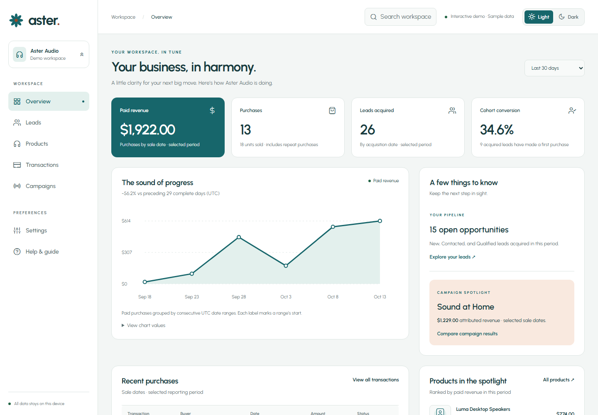
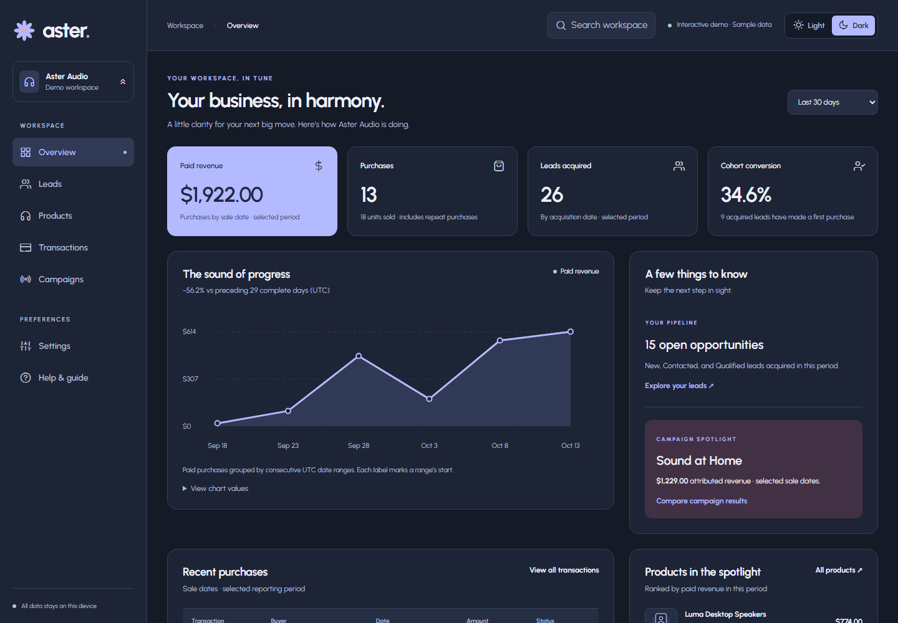
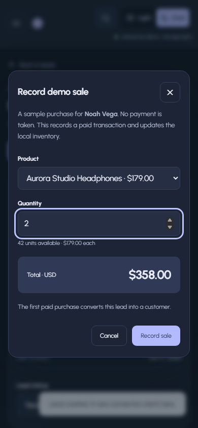

# Aster · Sales & Marketing Dashboard

A responsive frontend workspace for a fictional audio store. Create a lead, record a demo sale, and follow its effect across revenue, inventory, conversions, and campaign results.

[Explore the demo](https://dashboard-one-rose-14.vercel.app/dashboard) · [Watch the 3-minute walkthrough](https://dashboard-one-rose-14.vercel.app/walkthrough) · [Engineering decisions](docs/adr/0001-local-demo-session.md) · [Verification](docs/verification.md)



## Explore a connected workflow

1. Open **Leads** and add a contact with an acquisition source and optional origin campaign.
2. Update their stage, add a note, and choose **Record demo sale**.
3. Buy two Aurora Studio Headphones: a USD 358 transaction is created, stock falls from 42 to 40, and the lead becomes Converted.
4. Record another purchase of one unit: this customer's total revenue reaches USD 537, stock becomes 39, and the customer still counts as one conversion.
5. Inspect **Transactions**, **Products**, the dashboard, and the selected campaign. Export matching records or try a simulated marketing budget.

**Frontend only:** no account, API, database service, or real payment. All people and commercial records are fictional. Edits stay in browser storage on one device; Settings resets the demo after confirmation while retaining your theme.

## What works

- Lead creation, validation, search, filters, sorting, pagination, details, notes, and protected conversion stages.
- Paid demo transactions with stock checks, duplicate-submission protection, and coherent first and repeat purchases.
- Product performance and current inventory, lead segments and stage snapshots, campaign attribution, and a shared reporting period.
- A budget planner with USD amounts, allocations totaling 100%, baseline comparison, and persistence. Proposals never change achieved results.
- Global lead/product search and filtered CSV downloads across all matching pages, with escaped spreadsheet cells.
- Visible, remembered Light / Dark themes; responsive layouts, native dialogs, keyboard focus, reduced-motion support, and storage recovery feedback.

Revenue uses sale dates. Lead cohorts use acquisition dates and their current conversion outcome. Inventory is current availability. Campaign revenue follows the buyer’s origin campaign, including repeat purchases; unassigned purchases still contribute to overall revenue. Help explains these rules inside the app.

| Ink & periwinkle                                                                                                                                  | A sale on mobile                                                                                                                                                           |
| ------------------------------------------------------------------------------------------------------------------------------------------------- | -------------------------------------------------------------------------------------------------------------------------------------------------------------------------- |
|  |  |

## Engineering

**React 19.3 · TypeScript 6 · Expo SDK 58 · Expo Router · React Native Web · CSS · SVG · Playwright · axe-core**

The project retains its Expo and React Native Web foundation and targets **web**. Semantic HTML tables, forms, and browser dialogs are intentional; native Android and iOS apps are outside the delivered scope.

Thin routes delegate to feature screens. One typed session owns business records, while domain commands, storage validation, reporting, and CSV generation remain separate from rendering. Money uses integer cents. Stock and revenue derive from the transaction ledger; recording a sale and the first conversion is one state change. Browser tests exercise public workflows, reloads, downloads, date boundaries, and storage failures rather than private component state.

```text
app/                     Entry and thin Expo Router routes
features/aster/data/     Records, commands, persistence, reports, CSV
features/aster/           Feature screens, shared UI, theme tokens and CSS
tests/browser/           Behavior, accessibility and responsive checks
docs/                    Decisions, verification and portfolio screenshots
```

See the [dependency review](docs/dependency-review.md) for compatibility choices and remaining upstream audit findings.

## Run locally

Use **Node.js 24.x, version 24.3 or later** and npm. The clean installation was verified with Node 24.13.0. No environment variables or credentials are required.

```sh
git clone https://github.com/EPraz/dashboard.git
cd dashboard
npm ci
npm run web
```

For a production preview:

```sh
npm run build
npm run preview
```

Open [localhost:4173](http://localhost:4173). Vercel serves the same static `dist/` output, with fallback routing for direct links to browser-local records.

## Verify

```sh
npm run typecheck
npm run lint
npx playwright install chromium
npm test
```

The test command starts the local Expo server when needed. Set `PLAYWRIGHT_BASE_URL` to a running production preview or deployed URL to check that version instead. The verification record covers both themes at 320, 768, 1024, and 1440 pixels, keyboard and emulated touch navigation, and the complete lead-to-sale journey.

## Design notes

The dashboard composition evolved from image references chosen for the original project; their creator names and source links were not recorded. Aster adds its own identity, palettes, SVG product illustrations, and connected interactions. Urbanist is bundled locally under the [SIL Open Font License](public/fonts/OFL.txt); icons come from Feather through Expo Vector Icons.
